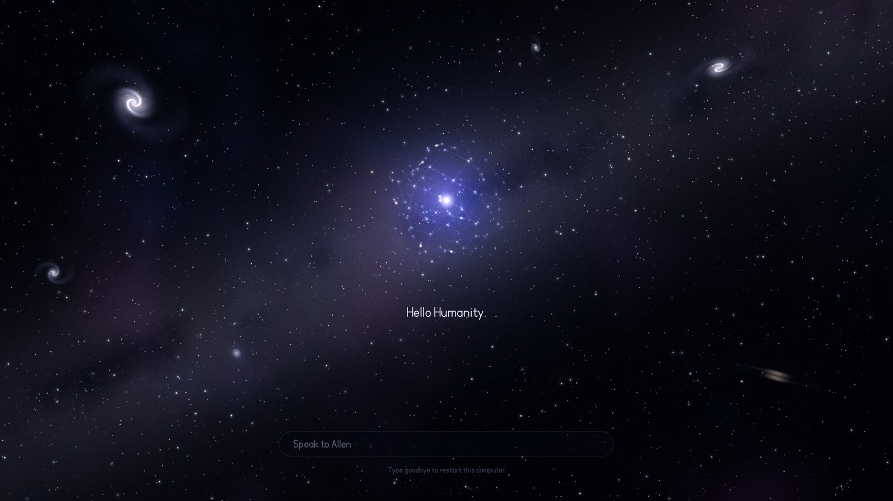

# Allen

**A presence you talk to, on a computer that runs our own kernel with nothing else underneath.**

Today Allen draws his own sky, remembers his name across restarts, takes a typed line and answers: "Hello Allen" gets "Hello Humanity", and anything he does not know gets "I don't know that yet." Asking our 27B model through him has run in an emulator, not yet on the real iMac.

[Meet Allen](https://www.aienos.com/allen/) ·
[What is happening now](https://www.aienos.com/now/) ·
[The code that draws him](https://github.com/aien-dev/aienos-mv/tree/903277b7ac5862d531fb5d6c00f0e66e7ef7cdb0/native/kernel/ui) ·
[Where Allen runs](#where-allen-runs) ·
[How Allen is drawn](#how-allen-is-drawn)

This frame was drawn by Allen's own code, run on a host computer by the project's test (<a href="https://github.com/aien-dev/aienos-mv/tree/903277b7ac5862d531fb5d6c00f0e66e7ef7cdb0/native/kernel/ui/tests">allen_ui_test.c</a>, commit 903277b). It is not a photograph of the iMac's screen.

## When you type goodbye

Allen's window ends the way a day ends. Everything falls into a black hole, its disk glows and dims, and the horizon closes to pure black. These are frames from the same test, one every 100 ms, played back at the speed they were drawn.

The dusk is on a branch, [feat/goodbye-event-horizon](https://github.com/aien-dev/aienos-mv/tree/feat/goodbye-event-horizon), and has run on a host computer only. It has not been shown on the real iMac.

## Where Allen runs

| Where | What Allen does there today | What has not happened yet | Receipt |
| :-- | :-- | :-- | :-- |
| **Intel iMac 2017** (bare metal: our C kernel, no Linux, no other operating system) | The whole screen is Allen's window, 3840 by 2160. In the 2026-10-19 boot report the night was drawn in 476 ms, his window was up 18.6 s after power on (15.9 s of that is the Mac's own firmware before our kernel starts), the startup sound was handed to the sound chip and began playing, and he loaded his memory from his own section of the disk: his name and 19 earlier starts. | The dusk animation, the model answers and the typed-line exchange with the 27B have not run on this machine. The kernel on it is on an open stack of pull requests, not on main. | boot report on the Spark (kept off GitHub), kernel [0930240d](https://github.com/aien-dev/aienos-mv/commit/0930240d2aa550de95535c116eb10c2df466f616), [open pull requests](https://github.com/aien-dev/aienos-mv/pulls) |
| **Raspberry Pi 5** (bare metal, AArch64) | The part of Allen that decides where a request should go (ALLEN REFLEX) runs in a native kernel image on the real Pi. In run pi5-allen-route-399b, 207 of 207 proposals matched the host's byte for byte and none granted anything. Median time per request 875 microseconds. | No screen and no typed input: Allen's window does not run on the Pi, and the image reads a card of requests, not a person. It is an open pull request, so not on main. | [pull request 402](https://github.com/aien-dev/aienos-mv/pull/402); the Pi also ran the kernel itself on 2026-10-13 ([evidence](https://github.com/aien-dev/aienos-mv/blob/main/evidence/pi5_hardware_runs_2026-10-13)) |
| **Windows PC with an RTX 5070** | In progress. This is the target for AIEN Rig, a local AI engine inside a 12 GiB budget. On the Spark under that budget the engine runs Qwen3-8B at 15.63 tokens per second in FP8 and 20.17 in 4-bit. | Nothing of ours has run on a 5070, and Allen is not on it. | [Rig engine receipts](https://github.com/aien-dev/aien-sovereign-core-mv/tree/rig/engine-12gb/docs/inference/evidence/rig-engine-20261019), [aien-rig](https://github.com/aien-dev/aien-rig) |
| **QEMU** (an emulator: a pretend computer inside a real one) | A typed line goes through the courier built into the kernel (over a serial line here, since the emulator has no network chip like the iMac's) to a relay, to the real 27B model, and the reply comes back into Allen's window: 22 of 22 checks. Every kernel gate runs here first. | An emulator qualifies nothing physical. The courier has not been tried over the iMac's real network chip. | branch [feat/allen-through-the-model](https://github.com/aien-dev/aienos-mv/tree/feat/allen-through-the-model), [kernel gates](https://github.com/aien-dev/aienos-mv/blob/main/native/kernel/GATES.md) |
| **NVIDIA DGX Spark** | Runs Linux and serves Qwen3.8-27B on our own GPU engine, so Allen has a model to ask. It is also where every frame on this page was drawn and where every speed receipt is made. | Allen's window does not run on the Spark. One Allen runs on the machine you sit at. | [27B server receipt](https://github.com/aien-dev/aien-sovereign-core-mv/tree/qwen38/serve-fast/evidence/qwen38-serve-fast-20261019), 7.63 tokens per second |

## How Allen is drawn

Everything on Allen's screen is drawn by about 3,500 lines of C in the kernel itself ([native/kernel/ui](https://github.com/aien-dev/aienos-mv/tree/903277b7ac5862d531fb5d6c00f0e66e7ef7cdb0/native/kernel/ui), at commit 903277b). There is no graphics library, no font file and no image file. These are the parts:

- **Integers only.** The drawing code has no floating point numbers. Sine and exponential tables are built when first used, by integer arithmetic, and everything after is whole numbers.
- **The sky** ([night.c](https://github.com/aien-dev/aienos-mv/blob/903277b7ac5862d531fb5d6c00f0e66e7ef7cdb0/native/kernel/ui/night.c)). The soft parts (the Milky Way, dust, glow) are worked out at a quarter of the screen's resolution and dithered up so the faint gradients show no bands. The stars and six galaxies are drawn at full resolution on top. This is a drawn sky, not a star catalogue; a version built from real star data is being made.
- **Bent light.** Two black holes spiral together and merge. Light round them bends by the point-mass lens equation: a star seen at angle theta really sits at theta minus E squared over theta, with E the Einstein radius. Stars behind a hole stretch into arcs, and a second image of each appears on the far side. When the holes merge, a ripple passes through the sky.
- **Allen himself** ([mind.c](https://github.com/aien-dev/aienos-mv/blob/903277b7ac5862d531fb5d6c00f0e66e7ef7cdb0/native/kernel/ui/mind.c)). A small sphere of points joined by lines, tilted 20 degrees toward you, with more points inside it.
- **Water and ink** ([flow.c](https://github.com/aien-dev/aienos-mv/blob/903277b7ac5862d531fb5d6c00f0e66e7ef7cdb0/native/kernel/ui/flow.c)). A tank of slightly thick water in 16.16 fixed point numbers. A push becomes a slow curl, not a splash, and both the ink and the motion fade on their own so the tank always comes to rest.
- **His handwriting** ([allen_font.c](https://github.com/aien-dev/aienos-mv/blob/903277b7ac5862d531fb5d6c00f0e66e7ef7cdb0/native/kernel/ui/allen_font.c)). Each letter is a short recipe of moves, lines and arcs, drawn with round ends as the distance to a centre line, so it is sharp at any size.
- **The startup sound** ([chirp.c](https://github.com/aien-dev/aienos-mv/blob/903277b7ac5862d531fb5d6c00f0e66e7ef7cdb0/native/kernel/ui/chirp.c)). Made from the same law that governs two merging black holes: the pitch rises as the share of the inspiral left to the power of minus three eighths, and the loudness follows. The iMac's boot report shows the sound chip starting it on the real machine.
- **Putting a frame together.** The screen is a grid of tiles 64 by 32 pixels. Each frame marks only the tiles that moved, groups them into strips that never overlap, and lets every core claim strips one at a time. The layout is designed on a 1920 by 1080 grid and scaled to the screen.

The dusk has its own checks in the host test: the light only falls after the disk's brightest moment, the middle of the screen is brighter than its edges mid-dusk, and the last frame is black in every pixel. A review of how true to real physics the pictures are is in progress, and the pictures claim no more than the checks above.

---

### The rest of AIEN

<picture>
  <source media="(prefers-color-scheme: dark)" srcset="assets/aienix-wordmark-dark.svg">
  
</picture>

**Persistent machine intelligence on hardware you own**

[What AIEN is](#what-aien-is) ·
[The machines](#the-machines) ·
[Speed, with receipts](#speed-with-receipts) ·
[Right now](#what-is-being-done-right-now) ·
[The tree](#the-tree) ·
[Research](#research) ·
[How a change gets in](#how-a-change-gets-in) ·
[Principles](#principles) ·
[Licence](#licence)

---

## What AIEN is

AIEN is a computing stack built to run on machines you own, with nothing in the trusted base that depends on an outside service: its own operating system kernel (AIENOS), its own language and GPU engine (Omega), a host runtime and model server in Rust, and a verification pipeline that judges every change and publishes the evidence. It is pre-alpha and says so. It started on one NVIDIA DGX Spark and now runs across several machines: the Spark serves a 27B model on our own GPU engine, an Intel iMac from 2017 boots the AIENOS kernel on bare metal, a Raspberry Pi 5 has run the same kernel on real hardware and hosts the project's house server, QEMU carries the emulator gates, and a Windows PC with an RTX 5070 is the target for AIEN Rig. The project is led by one engineer, Drake Stapleton, working with AI agents as day-to-day collaborators: the agents write, test and review; the engineer decides. Aienix is the name for the core tree these parts are being brought into. Every claim on this page links to the commit, pull request or evidence folder it comes from.

## The machines

| Machine | Role | What runs on it today | Last evidence | Link |
| :-- | :-- | :-- | :-- | :-- |
| **NVIDIA DGX Spark** (Grace Blackwell GB10, 128 GB unified memory, AArch64) | Development machine and the judge. Every speed receipt, every chip run and every agent run happens here. | Linux (vendor OS). Serves Qwen3.8-27B FP8 through our own server (aien-serve-http) on our own Omega GPU kernels. AIENOS native boot passed once on 2026-09-24 with the earlier Rust kernel; the current C kernel has not been booted on the Spark. | 2026-10-19 live server receipt, on branch qwen38/serve-fast | [receipt](https://github.com/aien-dev/aien-sovereign-core-mv/tree/qwen38/serve-fast/evidence/qwen38-serve-fast-20261019), [first boot 2026-09-24](https://github.com/aien-dev/aienos-mv/blob/main/evidence/m2_first_boot_2026-09-24.md) |
| **Intel iMac 2017** (iMac18,3, Core i5-7500, 16 GiB, AMD GPU) | Bare-metal lab machine for the AIENOS C kernel, x86_64 port. The whole screen is Allen's window (night sky, stars, black holes, Allen). | Boots the kernel from its own disk or netbooted from the Spark. The kernel it runs today is on the open pull request stack #414 to #424, not yet on main. | 2026-10-17 on main (all cores, both disks read, Ethernet seen); later daily boot reports are held on the Spark only | [evidence](https://github.com/aien-dev/aienos-mv/blob/main/evidence/imac_kernel1_2026-10-17), [x86 port](https://github.com/aien-dev/aienos-mv/blob/main/native/kernel/x86), [open PRs](https://github.com/aien-dev/aienos-mv/pulls) |
| **Raspberry Pi 5** (BCM2712, AArch64) | Two jobs: first real hardware for the AArch64 AIENOS kernel, and the project's house server on Linux. | Kernel runs are per test from an SD image (interrupts, four cores, user-mode tasks, scheduling, message passing, log to SD); no resident kernel is claimed. The house server runs readings-window and pi-register under Linux with systemd. | 2026-10-13 hardware runs on main; ALLEN REFLEX on the Pi image is open PR #402 (2026-10-18) | [evidence](https://github.com/aien-dev/aienos-mv/blob/main/evidence/pi5_hardware_runs_2026-10-13), [PR #402](https://github.com/aien-dev/aienos-mv/pull/402), [readings-window](https://github.com/aien-dev/readings-window) |
| **QEMU** (AArch64 virt with AAVMF; x86_64 q35 with OVMF) | The emulator path. Every kernel gate runs here first. QEMU qualifies nothing physical. | AIENOS kernel images (core only and full), the iMac kernel image, the Atlas boot seed, recovery images. | 24 of 24 emulator gates pass at 7f0de7e on 2026-10-09; the gate script now lists 26, so a newer receipt is owed | [gate receipt](https://github.com/aien-dev/aienos-mv/blob/main/evidence/ck_gates_29ed03c97454354a18676f768273dd7f7a8e15462c4be1939d9994d277d0d639.json), [GATES.md](https://github.com/aien-dev/aienos-mv/blob/main/native/kernel/GATES.md), [atlas](https://github.com/aien-dev/atlas) |
| **Windows PC with an NVIDIA RTX 5070** (12 GB) | Target for AIEN Rig: a local AI engine in a 12 GiB budget, a Windows frame-rate tuner, speech to text, a creator helper, one Windows app. | Nothing of ours has run on it yet. Rig builds pass on GitHub Actions (no GPU) and the engine is measured on the Spark under a 12 GiB budget. Pre-alpha, not physically qualified, no release yet. | 2026-10-19 CI green; engine numbers on branch rig/engine-12gb | [aien-rig](https://github.com/aien-dev/aien-rig), [engine receipts](https://github.com/aien-dev/aien-sovereign-core-mv/tree/rig/engine-12gb/docs/inference/evidence/rig-engine-20261019), [GPU port](https://github.com/aien-dev/omega-mv/tree/rig/gb20x/evidence/rig) |

## Speed, with receipts

A number here stands beside two things only: the machine's physical ceiling and our own previous run. We do not compare with anyone else's system. Every 27B number below is on a branch today; nothing is on main until the alpha merges land.

| What | Number | Against | Code | Receipt |
| :-- | :-- | :-- | :-- | :-- |
| **Qwen3.8-27B FP8 on Omega, live server decode** on the Spark GB10 (median of 4 runs of 256 greedy tokens) | **7.63 tokens/s** (131.05 ms per token). Real traffic over 22 replies: 7.52 tokens/s. | 0.752 of the 10.15 tokens/s memory ceiling. Our previous server binary: 6.29 tokens/s. | on branch qwen38/serve-fast (server) and omega qwen38/decode-speed (GPU library) | [2026-10-19](https://github.com/aien-dev/aien-sovereign-core-mv/tree/qwen38/serve-fast/evidence/qwen38-serve-fast-20261019) |
| **Memory ceiling** for that model on the GB10, one token at a time (arithmetic, not a measurement) | 10.15 tokens/s = 273 GB/s divided by 26,893,352,960 weight bytes | Practical ceiling at our best measured weight stream of 219 GB/s: 8.14 tokens/s | on branch alpha/ceiling-and-model | [CEILING.md](https://github.com/aien-dev/aien-sovereign-core-mv/blob/alpha/ceiling-and-model/docs/qwen38/CEILING.md) |
| **Fresh account test**: a new Linux user follows the public guide on the Spark and measures the server | 7.657 tokens/s (130.6 ms median); decoded tokens match the shipped reference | 0.754 of the 10.15 ceiling | on branch alpha/fresh-account-evidence. The install script failed at one step (exit 101) and the server was built by hand; the guide is not done until that is fixed | [2026-10-19](https://github.com/aien-dev/aien-sovereign-core-mv/tree/alpha/fresh-account-evidence/evidence/alpha-fresh-account-20261019) |
| **FP8 final word scoring step** against bf16, Qwen3.8-27B in process on the GB10 | FP8 head 8.452 tokens/s; bf16 head 8.048 tokens/s; saves 5.94 ms per token | Both give 24 of 24 golden tokens, but the FP8 head fails the full-model drift gate, so it stays off | on branch qwen38/w4-decode | [2026-10-19](https://github.com/aien-dev/aien-sovereign-core-mv/tree/qwen38/w4-decode/evidence/qwen38-ab-fp8head-w4-20261019T1230Z) |
| **4-bit weights (MXFP4), whole 27B model** on the GB10, chip shared with two servers | 72.60 to 76.16 ms per token across rounds | Our FP8 run in the same session: 119.35 ms per token. Tokens identical 24 of 24, but fails the FP8 drift gate as 4-bit is expected to; more rounds owed | on branch omega cascade/w4-gemv | [evidence folder](https://github.com/aien-dev/omega-mv/tree/cascade/w4-gemv/evidence) |
| **Rig engine, 12 GiB budget**: Qwen3-8B FP8 on the Omega dense door, measured on the Spark GB10 under a 12 GiB device budget, not on an RTX 5070 | 15.63 tokens/s; 5 of 5 golden prompts identical | No ceiling published yet for this model and budget | on branch rig/engine-12gb | [chip-fp8](https://github.com/aien-dev/aien-sovereign-core-mv/tree/rig/engine-12gb/docs/inference/evidence/rig-engine-20261019/chip-fp8) |
| **Rig engine, 12 GiB budget**: Qwen3-8B MXFP4, same door, same machine, device memory 5.158 GiB | 20.17 tokens/s; 5 of 5 golden prompts identical; the swap-kv negative control fails as it must | Our FP8 run above: 15.63 tokens/s | on branch rig/engine-12gb | [chip-w4-ceil](https://github.com/aien-dev/aien-sovereign-core-mv/tree/rig/engine-12gb/docs/inference/evidence/rig-engine-20261019/chip-w4-ceil) |
| **Cold time to first token at long context**, Qwen3.8-27B FP8 on the GB10 | 128k tokens: 936.7 s (32k and 64k in the receipt) | No previous run | on branch qwen38/prefill-ttft, carried on rig/engine-12gb | [2026-10-18](https://github.com/aien-dev/aien-sovereign-core-mv/tree/rig/engine-12gb/evidence/qwen38-prefill-20261018T1836Z) |
| **Exhaustive FP32 square root** on the physical GB10 (correctness, not speed) | 4,294,967,296 inputs, 0 mismatches | Not applicable | on main | [omega PR #141](https://github.com/aien-dev/omega-mv/pull/141) |

Numbers still being worked are not in this table: continuous batching on the 27B door (about 7.0 tokens/s single door, batch runs pending, [receipt](https://github.com/aien-dev/aien-sovereign-core-mv/tree/cascade/continuous-batching/evidence/qwen38-batch-20261019T1630Z)) and the MTP chain (5.80 tokens accepted per pass at k=8, wall speed not yet reported, [receipt](https://github.com/aien-dev/aien-sovereign-core-mv/tree/cascade/mtp-chain/evidence/qwen38-cascade-20261019T1611Z)).

## What is being done right now

The live ledger is at **[www.aienos.com/now/](https://www.aienos.com/now/)**. It renders the project's coordination ledger as it is written: every line is a promise with an owner and an observable finish, agents write their progress there, the operator writes decisions there, and nothing on it is composed by hand. The streams in motion today:

- **Engine speed cascade** on the 27B: a tree-verify GEMM, an MTP chain with a second drafter, 4-bit decode, continuous batching, prefill kernels, document memory up to 32k, and a drafter model; each lands as a receipt on a branch of [omega-mv](https://github.com/aien-dev/omega-mv) and [aien-sovereign-core-mv](https://github.com/aien-dev/aien-sovereign-core-mv).
- **Alpha release**, scoped to the model server only (install, download, start, chat with Qwen3.8-27B on Omega from public steps): three merges queued, the [public guide](https://github.com/aien-dev/aien-sovereign-core-mv/blob/alpha/try-it-guide/docs/qwen38/TRY_IT_ON_YOUR_SPARK.md) on a branch, and the install-script failure from the fresh-account test to fix first.
- **AIEN Rig** for RTX gaming PCs: engine in a 12 GiB budget, the rig-tune frame-rate tuner, speech to text, a creator helper and a Windows app; builds pass on GitHub Actions, nothing has run on the 5070 yet, [0 releases](https://github.com/aien-dev/aien-rig/releases).
- **AIENOS on the iMac**: the [open pull request stack](https://github.com/aien-dev/aienos-mv/pulls) (netboot, keyboard, boot disk, screensaver), the goodbye animation, and Allen talking to the 27B through a UDP courier in the kernel (host tests pass, QEMU end to end next).
- **AIENOS on the Pi 5**: ALLEN REFLEX decision making on the native Pi image ([PR #402](https://github.com/aien-dev/aienos-mv/pull/402)) and the Pi to Spark task protocol ([PST1 draft](https://github.com/aien-dev/aien-protocols-mv/pull/34)).
- **Research programme**: an offline cost simulator ([omega #583](https://github.com/aien-dev/omega-mv/issues/583)), a bounded learning-mechanism search ([omega #584](https://github.com/aien-dev/omega-mv/issues/584)), the plan-reuse payback campaign ([architecture #276](https://github.com/aien-dev/aien-architecture-mv/issues/276)), and a published verdict on a symbolic rewrite layer ([VERDICT.md](https://github.com/aien-dev/omega-mv/blob/symbolic/rewrite-layer/evidence/symbolic-rewrite/VERDICT.md): cut 2 of 7 action graphs, no measurable cut on 27B decode).
- **Public record**: the Spark becomes the sole test judge with the hosted check only confirming the bundle ([aienos PR #397](https://github.com/aien-dev/aienos-mv/pull/397)), signed receipts in [aien-receipts](https://github.com/aien-dev/aien-receipts), every agent chat in [agent-archive](https://github.com/aien-dev/agent-archive), and uncommitted agent work snapshotted to wip branches so no measurement stays on one disk.

## The tree

Aienix is the reserved home for the core tree; the code still lives in the component repositories below and will be imported one at a time with full history. Repository names end in `-mv` today; the older names reach them only through GitHub's redirect.

### Core

| Repository | What it is |
| :-- | :-- |
| [aienos-mv](https://github.com/aien-dev/aienos-mv) | AIENOS: our own operating system kernel in C (AArch64 for the Spark and the Pi 5, x86_64 for the iMac), the QEMU gates, and Allen's window. Pre-alpha. |
| [omega-mv](https://github.com/aien-dev/omega-mv) | Omega: the reaction runtime and compiler in C, with its own GB10 GPU engine (the kernels that run the 27B). |
| [aien-sovereign-core-mv](https://github.com/aien-dev/aien-sovereign-core-mv) | Host runtime in Rust on Linux: the `aien` CLI and daemon, inference ABI, KV cache, scheduler, the Spark judge, and the 27B model server (aien-serve-http). |
| [aien-architecture-mv](https://github.com/aien-dev/aien-architecture-mv) | The authority for how AIEN fits together: decision records, milestone status, execution plan. |
| [aien-protocols-mv](https://github.com/aien-dev/aien-protocols-mv) | Written contracts between the parts: byte formats, schemas, test vectors, including the Pi to Spark task protocol. |
| [physics-mv](https://github.com/aien-dev/physics-mv) | FORGE machine realization layer in C and the boot artefacts for the GB10 path (QEMU qualified only so far). |
| [aienix](https://github.com/aien-dev/aienix) | Reserved home for the one core tree. Planning stage. |

### Machines, boot and record

| Repository | What it is |
| :-- | :-- |
| [aien-rig](https://github.com/aien-dev/aien-rig) | Local AI and a measured frame-rate tuner for RTX gaming PCs (RTX 5070 first): engine, tuner, speech, creator, app. Pre-alpha. |
| [atlas](https://github.com/aien-dev/atlas) | The boot seed: a 1,480-byte AArch64 stage that verifies the next image by SHA-256. QEMU qualified; native Spark pending. |
| [rpi5-uefi](https://github.com/aien-dev/rpi5-uefi) and [edk2-non-osi](https://github.com/aien-dev/edk2-non-osi) | Preservation fork of the Raspberry Pi 5 UEFI firmware chain (upstream archived). |
| [readings-window](https://github.com/aien-dev/readings-window) | Read-only, token-protected HTTPS window onto the Spark's GPU and CPU readings, served from the Pi house server (Rust). Running. |
| [pi-register](https://github.com/aien-dev/pi-register) | Register of the services on the Pi house server (Rust CLI and a register file, 32 services). |
| [aien-receipts](https://github.com/aien-dev/aien-receipts) | Signed verification receipts published by the Spark judge, data only, append only. |
| [benchmarks-mv](https://github.com/aien-dev/benchmarks-mv) | Measurement harnesses and evidence bundles for AIEN on the Spark. |
| [agent-archive](https://github.com/aien-dev/agent-archive) | Archive of every AI agent chat on the Spark: one record schema, verbatim raw mirror. |
| [aien-edge](https://github.com/aien-dev/aien-edge) | Rust edge web server meant for a Pi so the Spark never faces the internet. Not in use; the sites are on GitHub Pages. |

### Attachments and services

| Repository | What it is |
| :-- | :-- |
| [aien-translate](https://github.com/aien-dev/aien-translate) | Translation server for translate.js backed by the live 27B on our own runtime: no API key, text stays on the machine. In use. |
| [synapse](https://github.com/aien-dev/synapse) | Agent-native changeset and coordination service with Git and Radicle interoperability. |
| [interplane-mv](https://github.com/aien-dev/interplane-mv) | INTERPLANE: open protocol between models and agent runtimes. Models express intent; runtimes keep authority. Apache-2.0 today. |
| [aegis-runtime-mv](https://github.com/aien-dev/aegis-runtime-mv) | Agent runtime in Rust: local gateway, heartbeat scheduler, task workflow, SQLite. Pre-alpha. |
| [spark-rsi-mv](https://github.com/aien-dev/spark-rsi-mv) | Recursive self-improvement engine in Rust: proposes small code changes, tests them in a sandbox, hands a review branch to a human. |
| [open-humanity](https://github.com/aien-dev/open-humanity) | Opt-in, privacy-first peer assistance network for agents in distress. Early prototype; not yet judged by the Spark pipeline. |

### Sites and forks

| Repository | What it is |
| :-- | :-- |
| [aienos.com](https://github.com/aien-dev/aienos.com) | Source of [www.aienos.com](https://www.aienos.com) (Rust generator, GitHub Pages). |
| [interplane.io](https://github.com/aien-dev/interplane.io) | Source of interplane.io, rebuilt hourly from the Spark. |
| [translate](https://github.com/aien-dev/translate) | Fork of translate.js kept for aien-translate (MIT). |
| [t3code](https://github.com/aien-dev/t3code) | Fork of t3code holding one pending contribution (MIT). |

Archived repositories are not listed. Each directory in the core repositories carries a `.crumb` file describing its purpose; a change that leaves the crumbs stale fails its gate.

## Research

Papers are published at [www.aienos.com/research/](https://www.aienos.com/research/), each with a PDF and a SHA256SUMS file. None is peer reviewed.

| Title | Kind | Date | DOI or link |
| :-- | :-- | :-- | :-- |
| Computing Machinery and Understanding: From the Imitation Game to the Turing | formal preprint | 2026-10-02 | [10.5281/zenodo.23437498](https://doi.org/10.5281/zenodo.23437498) |
| Computing Machinery and Understanding: The Turing as a Measure Emerging from AIEN | companion paper | 2026-10-02 | [10.5281/zenodo.23437568](https://doi.org/10.5281/zenodo.23437568) |
| The Stapleton Doctrine: A Personal Philosophy of AI Architecture and Programming | position paper, v1.5 | 2026-10-02 | [PDF](https://www.aienos.com/research/the-stapleton-doctrine/paper.pdf) |
| The Turing: A Unit of Verified Explanatory Gain | brief, v1.4 | 2026-10-02 | [PDF](https://www.aienos.com/research/the-turing-brief/paper.pdf) |
| The Turing Discovery Gap Conjecture | conjecture, rev 9 | 2026-10-02 | [PDF](https://www.aienos.com/research/turing-discovery-gap-conjecture/paper.pdf) |
| The Crumb Doctrine | doctrine, v1.4 | 2026-10-02 | [PDF](https://www.aienos.com/research/crumb-doctrine/paper.pdf) |
| Omega: A Programming Language Built for Verified Programs | language design proposal | 2026-10-02 | [PDF](https://www.aienos.com/research/omega-language/paper.pdf) |
| The Atemporal AIEN Postulate | postulate, v1.1 | 2026-10-02 | [PDF](https://www.aienos.com/research/atemporal-aien-postulate/paper.pdf) |
| The AIEN Papers: The Complete Collection | collection, 120 pages | 2026-10-02 | [PDF](https://www.aienos.com/research/the-aien-papers/paper.pdf) |
| Turing instrument calibration and laboratory execution protocols | protocol PDFs, v1.0 | | [on GitHub](https://github.com/aien-dev/omega-mv/blob/main/docs/turing/protocols/turing-instrument-calibration-validation-protocol-v1-0.pdf) |

The research status record (what is measured, what is blocked) is at [www.aienos.com/research/status/](https://www.aienos.com/research/status/).

## How a change gets in

Pull requests in the core repositories are judged on the Spark itself, by our own pipeline, not by a hosted runner.

1. **A gate manifest** in the repository declares each test, the files it depends on, and what counts as a pass.
2. **The judge** checks out the exact commit, reruns only the gates whose inputs changed, and writes an evidence bundle: per-gate verdicts, exit codes, and content-addressed logs.
3. **The verdict is signed and published** to the pull request. The hosted GitHub check does one thing only: confirm that the published bundle matches the commit.
4. **A maintainer labels the change** `ready-to-merge`. The pipeline merges it when the Spark bundle passes and the hosted check agrees. Nothing merges on a green badge alone.

What is true today beyond the core: aien-rig is checked on GitHub Actions (windows-latest, no GPU) because its target is a Windows machine the Spark cannot stand in for, and open-humanity is not yet judged by the Spark pipeline. The design is recorded in the architecture repository as [ADR 0033](https://github.com/aien-dev/aien-architecture-mv/tree/main/docs/adr).

To get involved: read the [architecture repository](https://github.com/aien-dev/aien-architecture-mv) first (its `PLAN_AUTHORITY.md` says which document wins when two disagree), open issues on the component repository the change belongs to, and expect every contribution to be judged as above.

## Principles

- **Closest to the metal.** The fastest correct path wins. Software stays out of the hardware's way, and headline numbers are reported as a fraction of the machine's physical limit.
- **Sovereign.** No outside dependencies in the trusted base (the kernel, Omega, the host runtime): no CUDA toolkit, no systemd, no Python there, and builds are offline and reproducible. Outside the trusted base today: aien-rig describes its own C++/CUDA engine for RTX cards, and the Pi house server runs Linux with systemd services.
- **Rust is scaffolding, Omega is the destination.** Rust carries the host runtime today; the long-term home for every component is Omega. C only where the hardware justifies it, assembly only where measured.
- **Evidence or nothing.** A result is not demonstrated until a receipt for it exists. A target is never evidence of itself.
- **Compare only with ourselves.** Progress is measured against the machine's physical ceiling and our own previous run, never against other people's systems.
- **Open.** The project's own code is public under AGPL-3.0-or-later. The one exception today is interplane-mv, which is Apache-2.0 with an AGPL branch pushed and not yet merged. Forks keep their upstream licences. The model served today is Qwen3.8-27B under Qwen's own licence; no AIEN-trained weights exist yet.

## Licence

AGPL-3.0-or-later for the tree ([LICENSE](https://github.com/aien-dev/aienix/blob/main/LICENSE)), except interplane-mv, which is Apache-2.0 today. See each repository's own LICENSE file.

Aienix is not a UNIX and makes no such claim. UNIX is a registered trademark of The Open Group. NVIDIA, DGX and Grace Blackwell are trademarks of NVIDIA Corporation. Raspberry Pi is a trademark of Raspberry Pi Ltd.
