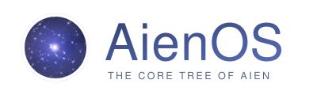
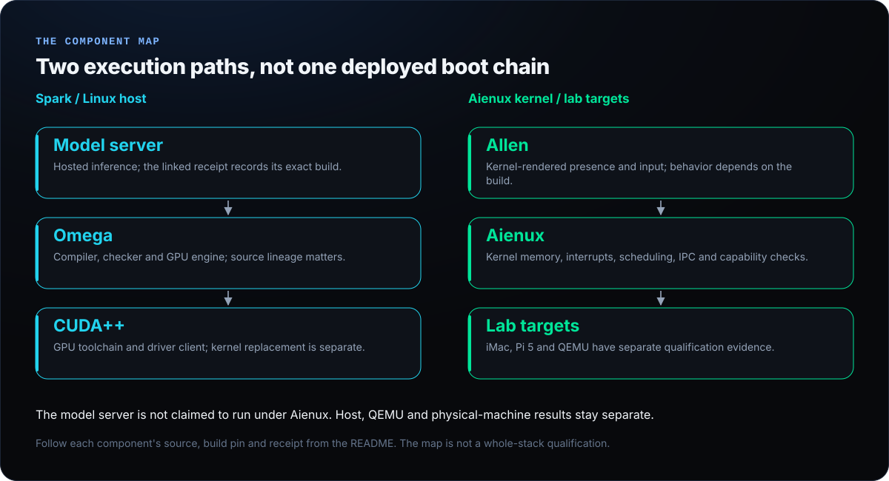
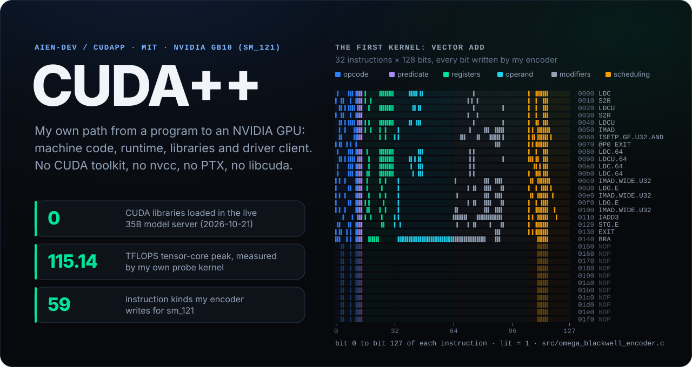
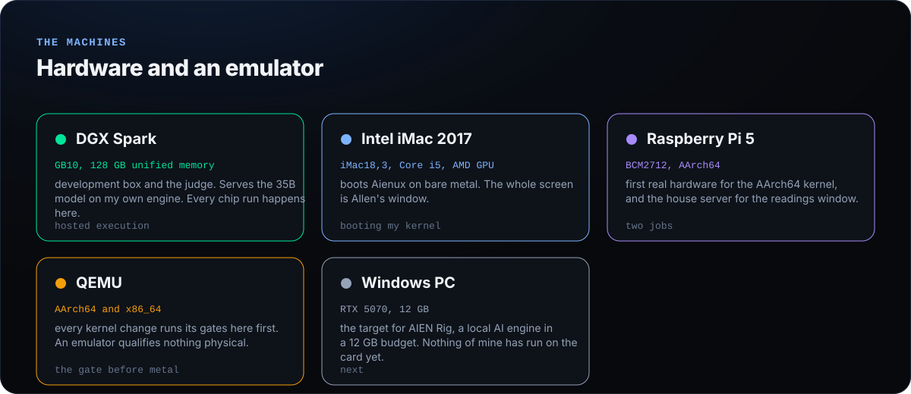
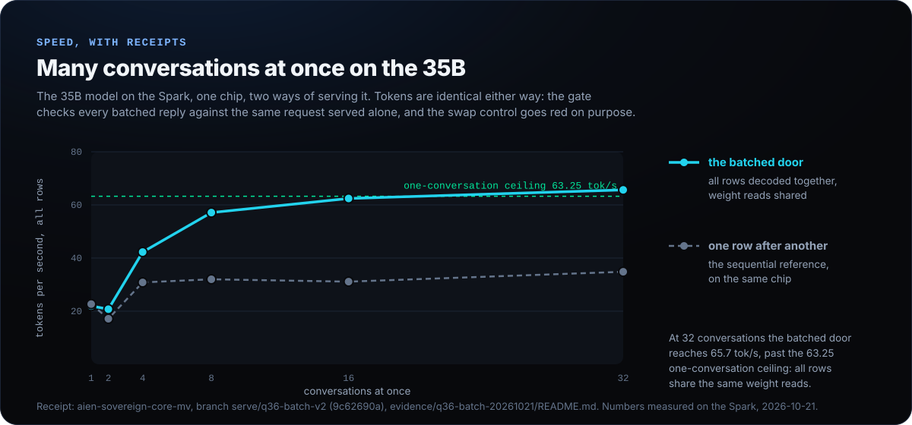
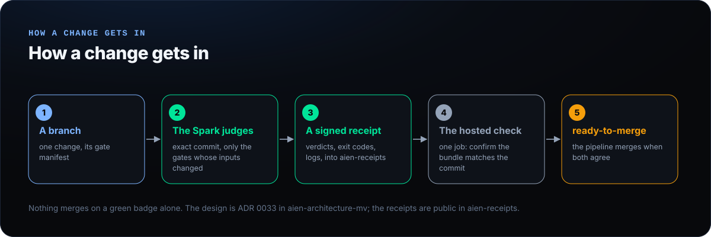

<picture>
  <source media="(prefers-color-scheme: dark)" srcset="assets/aienos-wordmark-dark.svg">
  
</picture>

**Persistent machine intelligence on hardware I own.**

[Start learning](#start-here) ·
[Explore the source](#the-tree) ·
[Tags and downloads](#tags-and-downloads) ·
[Evidence](#speed-with-receipts) ·
[Contribute](https://github.com/aien-dev/.github/blob/main/CONTRIBUTING.md)

## What this is

I am Drake Stapleton. I am building a computing stack for hardware I own: the Aienux kernel, Omega, CUDA++, a host runtime and Allen. I direct AI agents as implementation, testing and review tools. The goal is a self-owned trusted base and results that can be traced to their source. Existing C and Rust paths, seed-born Omega work and hardware qualification are distinct stages, not one finished replacement.

> [!NOTE]
> **Pre-alpha, with evidence rather than a blanket readiness claim.** The front door pins separate component repositories. A published tag, a host test, an emulator run and a physical-machine result establish different things. Branch-only work is labelled below; private component details are not published here.

## Start here

| If you want to… | Start with | What you get |
| :-- | :-- | :-- |
| **Understand the stack** | [AienOS learning front door](https://github.com/aien-dev/aienix) · [teaching tracker](https://github.com/aien-dev/aienix/issues/9) | A no-specialist-hardware route, source walkthroughs, prerequisites and expected results. |
| **Read the GPU implementation** | [CUDA++](https://github.com/aien-dev/CUDApp) | Machine-code encoding, driver boundaries and the existing first-kernel guide. |
| **Follow decisions into code** | [Architecture and ADRs](https://github.com/aien-dev/aien-architecture-mv) | Design reasons, contracts and implementation mapping. |
| **Check a claim** | [Receipt shelf](https://github.com/aien-dev/aien-receipts) · [research status](https://www.aienos.com/research/status/) | Exact-source verdicts, retained failures and qualification boundaries. |
| **Find current work** | [Live work ledger](https://www.aienos.com/now/) · [repositories by topic](https://github.com/orgs/aien-dev/repositories?q=topic%3Aaienos) | Named work and repository discovery, not an assertion that everything is complete. |

The banner and Allen animation come from the kernel's own renderer, not generated promotional art. [Website](https://www.aienos.com) · [Contribution guide](https://github.com/aien-dev/.github/blob/main/CONTRIBUTING.md) · [Support](https://github.com/aien-dev/.github/blob/main/SUPPORT.md) · [Security policy](https://github.com/aien-dev/.github/blob/main/SECURITY.md)

## The stack

The Spark model server is Linux-hosted; Allen and Aienux have a separate bare-metal/emulator path. This is a component map, not a claim that the deployed model server runs under the new kernel.

## Allen

Allen is the resident presence of the kernel. His window takes the whole screen of the iMac: a night sky with two black holes whose gravity bends the starlight, water that moves with what he is doing, a name he asks for at first meeting and keeps, and a typed line he answers from. Everything on his screen is drawn by the kernel's own C code: no graphics library, no font file, no image file.

When you type goodbye, his day ends the way a day ends: everything falls into a black hole, its disk glows, and the horizon closes. The banner at the top and this dusk are frames from the kernel's own renderer, run by its test on a host computer; the dusk is on branch [feat/goodbye-event-horizon](https://github.com/aien-dev/aienux/tree/feat/goodbye-event-horizon) and has not been shown on the real iMac yet. How he is drawn: [native/kernel/ui](https://github.com/aien-dev/aienux/tree/main/native/kernel/ui).

## CUDA++

[CUDA++](https://github.com/aien-dev/CUDApp) is the GPU half of Omega as its own MIT project: the toolchain that writes the GPU's machine code, the runtime, the libraries and the driver client, with no CUDA toolkit, no `nvcc`, no PTX and no `libcuda`. I reverse engineered the undocumented machine code of the GB10 and wrote my own encoder for it; the whole method is in [docs/HOW_I_DID_IT.md](https://github.com/aien-dev/CUDApp/blob/main/docs/HOW_I_DID_IT.md) and the driver is explained part by part on the [repository front page](https://github.com/aien-dev/CUDApp). A retained 2026-10-21 receipt records a 35B model server running on it with zero CUDA libraries loaded ([receipt](https://github.com/aien-dev/omega-mv/blob/89aad7c99b4fced80f92b656d2a3f350699456f0/evidence/WHAT-OMEGA-IS-20261021/live-serve-no-cuda.txt)); next it replaces NVIDIA's kernel modules ([L332](https://www.aienos.com/now/#L332)) and swaps in as a drop-in `libcuda` ([L401](https://www.aienos.com/now/#L401)).

## The machines

- **DGX Spark** is the development and verification host. The [retained 2026-10-21 model-server receipt](https://github.com/aien-dev/omega-mv/blob/89aad7c99b4fced80f92b656d2a3f350699456f0/evidence/WHAT-OMEGA-IS-20261021/live-serve-no-cuda.txt) records its mapped libraries; this profile refresh is not a new live-server qualification.
- **Intel iMac 2017** boots [Aienux](https://github.com/aien-dev/aienux) on bare metal; [boot evidence](https://github.com/aien-dev/aienux/tree/main/evidence/imac_kernel1_2026-10-17). The kernel it runs is on an [open pull request stack](https://github.com/aien-dev/aienux/pulls), not yet main.
- **Raspberry Pi 5** ran the same kernel on real hardware ([evidence](https://github.com/aien-dev/aienux/tree/main/evidence/pi5_hardware_runs_2026-10-13)) and hosts the [readings window](https://github.com/aien-dev/readings-window).
- **QEMU** provides the kernel emulator-gate route; an emulator qualifies nothing physical ([gates](https://github.com/aien-dev/aienux/blob/main/native/kernel/GATES.md)).
- **Windows PC, RTX 5070** is the target for [AIEN Rig](https://github.com/aien-dev/aien-rig): a local AI engine in a 12 GB budget, measured so far on the Spark ([receipts](https://github.com/aien-dev/aien-sovereign-core-mv/tree/rig/engine-12gb/docs/inference/evidence/rig-engine-20261019)). Nothing of mine has run on the card yet.

## Tags and downloads

These are **existing GitHub tags and published prereleases**, checked on 2026-10-22, not new release claims. Read each release's own platform, assets and limitations before running anything. No tag was created or moved for this page.

| Component | Actual GitHub feature | Scope |
| :-- | :-- | :-- |
| CUDA++ | [alpha-0.1 prerelease](https://github.com/aien-dev/CUDApp/releases/tag/alpha-0.1) · [all tags](https://github.com/aien-dev/CUDApp/tags) | GPU project only; read its hardware limits. |
| Aienux | [alpha-0.1 prerelease](https://github.com/aien-dev/aienux/releases/tag/alpha-0.1) · [all tags](https://github.com/aien-dev/aienux/tags) | Kernel artifact, not a whole-system installer or a bare-metal qualification. |
| Host runtime | [v0.1.1 prerelease](https://github.com/aien-dev/aien-sovereign-core-mv/releases/tag/v0.1.1) · [all releases](https://github.com/aien-dev/aien-sovereign-core-mv/releases) | Historical runtime assets; not current-main qualification. |
| Omega | [actual tags](https://github.com/aien-dev/omega-mv/tags) | Experiment/provenance tags include failures. No published release at audit. |
| FORGE | [demo-l182-v1 tag](https://github.com/aien-dev/physics-mv/tree/demo-l182-v1) | Demo source identity; no product release. |

**AienOS has no published whole-stack release in this inventory.** Empty release pages do not become downloads because the profile looks polished. Draft releases are not advertised as public availability. Upstream tags in preservation forks retain their original attribution.

## Speed, with receipts

The following are retained **historical experiment snapshots**, not live telemetry or a fresh benchmark run. The linked source and receipt define each result's scope.

| What | Number | Against | Receipt |
| :-- | :-- | :-- | :-- |
| **35B model, many conversations at once** (batched door, all tokens checked identical to serving each request alone) | 65.7 tokens/s total at 32 conversations | 63.25 tokens/s, the one-conversation ceiling: batching passes it because rows share weight reads | [branch serve/q36-batch-v2, evidence](https://github.com/aien-dev/aien-sovereign-core-mv/tree/serve/q36-batch-v2/evidence/q36-batch-20261021) |
| **27B model, live server decode**, median of 4 runs of 256 greedy tokens | 7.63 tokens/s | 0.752 of that model's 10.15 tokens/s memory ceiling; my previous server: 6.29 | [branch qwen38/serve-fast, evidence](https://github.com/aien-dev/aien-sovereign-core-mv/tree/qwen38/serve-fast/evidence/qwen38-serve-fast-20261019) |
| **Ceiling probes on the GB10**, my own kernels | 115.14 TFLOPS tensor-core peak, 195.1 GB/s reads | the machine's physical limits, measured | [in CUDA++, evidence](https://github.com/aien-dev/CUDApp/tree/main/evidence/OWN30B-T3-TC-PEAK-BW-5faa0f70-20261013T2236Z) |

Numbers on branches say so. Same-model comparison work is tracked separately ([L394](https://www.aienos.com/now/#L394)); this retained snapshot does not assert its current execution status or invent a comparison result.

## Follow the work

The live ledger is at **[www.aienos.com/now/](https://www.aienos.com/now/)**. Consult it for current state rather than interpreting the following linked workstreams as completed or still running solely because they appear on this page:

- **The 35B faster**: batch strokes (above), the motor that serves several strokes per weight read, document reads split across eight batch rows, and the head-to-head against llama.cpp and vLLM.
- **CUDA++** ([L395](https://www.aienos.com/now/#L395)): CUDA's pain points with the fix for each shown as a command and a receipt, the swap down to the kernel driver ([L401](https://www.aienos.com/now/#L401)), and my own GB10 kernel driver ([L332](https://www.aienos.com/now/#L332)).
- **Alpha** ([L388](https://www.aienos.com/now/#L388)): one tagged release a stranger can install and run; the public guide and the install-script failure it hit are tracked in the open.
- **Aienux on the iMac**: the open pull request stack (netboot, keyboard, boot disk) and Allen talking to the model through a courier in the kernel.
- **Research programme**: an offline cost simulator, a bounded learning-mechanism search, and a published verdict on a symbolic rewrite layer ([cut 2 of 7 action graphs, no measurable win on 27B decode](https://github.com/aien-dev/omega-mv/blob/symbolic/rewrite-layer/evidence/symbolic-rewrite/VERDICT.md)).

## The tree

The core repositories. **AienOS** is the operating-system project; **Aienux** is its kernel. The legacy `aienix` repository address is retained as the pinned front door, not a second product name.

| Repository | What it is |
| :-- | :-- |
| [aienix, the AienOS front door](https://github.com/aien-dev/aienix) | Pinned component identities, learning routes and the cross-repository teaching tracker. Not a completed monorepo import. |
| [aienux](https://github.com/aien-dev/aienux) | Aienux: my operating system kernel in C, the QEMU gates, and Allen's window. Pre-alpha. |
| [omega-mv](https://github.com/aien-dev/omega-mv) | Omega: my language for verified programs, its checker, and the GB10 GPU engine. |
| [CUDApp](https://github.com/aien-dev/CUDApp) | CUDA++: the GPU half of Omega on its own, MIT. No NVIDIA user-space software. |
| [aien-sovereign-core-mv](https://github.com/aien-dev/aien-sovereign-core-mv) | Host runtime in Rust: the `aien` CLI and daemon, the Spark judge, the model server. |
| [aien-architecture-mv](https://github.com/aien-dev/aien-architecture-mv) | The authority for how AIEN fits together: decision records and the execution plan. |
| [aien-protocols-mv](https://github.com/aien-dev/aien-protocols-mv) | Written contracts between the parts: byte formats, schemas, test vectors. |
| [physics-mv](https://github.com/aien-dev/physics-mv) | Machine realization layer in C and the GB10 boot artefacts. |
| [aien-rig](https://github.com/aien-dev/aien-rig) | Local AI and a measured frame-rate tuner for RTX gaming PCs. Pre-alpha. |
| [interplane-mv](https://github.com/aien-dev/interplane-mv) | INTERPLANE: an open protocol between models and agent runtimes. Apache-2.0. |

<strong>Record, boot and services</strong> (the rest of the tree)

| Repository | What it is |
| :-- | :-- |
| [aien-receipts](https://github.com/aien-dev/aien-receipts) | Signed verification receipts published by the Spark judge. Data only, append only. |
| [benchmarks-mv](https://github.com/aien-dev/benchmarks-mv) | Measurement harnesses and evidence bundles. |
| [agent-archive](https://github.com/aien-dev/agent-archive) | Every AI agent chat on the Spark, one schema, verbatim. |
| [atlas](https://github.com/aien-dev/atlas) | The boot seed: 1,480 bytes that verify the next image by SHA-256. |
| [synapse](https://github.com/aien-dev/synapse) | Agent-native changeset and coordination service. |
| [aegis-runtime-mv](https://github.com/aien-dev/aegis-runtime-mv) | Agent runtime in Rust. Pre-alpha. |
| [spark-rsi-mv](https://github.com/aien-dev/spark-rsi-mv) | Proposes small code changes, tests them in a sandbox, hands a review branch to me. |
| [open-humanity](https://github.com/aien-dev/open-humanity) | Opt-in peer assistance network for agents in distress. Prototype. |
| [readings-window](https://github.com/aien-dev/readings-window) | Read-only window onto the Spark's readings, served from the Pi. Running. |
| [pi-register](https://github.com/aien-dev/pi-register) | Register of the services on the Pi house server. |
| [aien-translate](https://github.com/aien-dev/aien-translate) | Translation server backed by the live model on my own runtime: no API key, text stays on the machine. In use. |
| [rpi5-uefi](https://github.com/aien-dev/rpi5-uefi), [edk2-non-osi](https://github.com/aien-dev/edk2-non-osi) | Preservation fork of the Pi 5 UEFI firmware chain. |
| [aienos.com](https://github.com/aien-dev/aienos.com) | Source of [www.aienos.com](https://www.aienos.com). |
| [interplane.io](https://github.com/aien-dev/interplane.io), [translate](https://github.com/aien-dev/translate), [t3code](https://github.com/aien-dev/t3code) | Site rebuilt hourly from the Spark, and two forks kept for contributions. |

## How a change gets in

The gate manifests, judge and intended verification workflow are described in [aien-architecture-mv](https://github.com/aien-dev/aien-architecture-mv) ([ADR 0033](https://github.com/aien-dev/aien-architecture-mv/tree/main/docs/adr)). Actual coverage depends on repository enrollment and the exact revision's manifest and required checks. To take part, open an issue in the component repository and include the reproduction and evidence that its contribution guide requires.

<strong>Research</strong> (preprints, none peer reviewed)

Papers live at [www.aienos.com/research/](https://www.aienos.com/research/), each with a PDF and a SHA256SUMS file; what is measured and what is blocked is at [www.aienos.com/research/status/](https://www.aienos.com/research/status/). Recent:

| Title | Kind | Link |
| :-- | :-- | :-- |
| Computing Machinery and Understanding: From the Imitation Game to the Turing | preprint | [10.5281/zenodo.23437498](https://doi.org/10.5281/zenodo.23437498) |
| Computing Machinery and Understanding: The Turing as a Measure Emerging from AIEN | companion | [10.5281/zenodo.23437568](https://doi.org/10.5281/zenodo.23437568) |
| The Stapleton Doctrine | position paper | [PDF](https://www.aienos.com/research/the-stapleton-doctrine/paper.pdf) |
| The Turing: A Unit of Verified Explanatory Gain | brief | [PDF](https://www.aienos.com/research/the-turing-brief/paper.pdf) |
| Omega: A Programming Language Built for Verified Programs | language design | [PDF](https://www.aienos.com/research/omega-language/paper.pdf) |
| The AIEN Papers: The Complete Collection | collection, 120 pages | [PDF](https://www.aienos.com/research/the-aien-papers/paper.pdf) |

## Principles

- **Closest to the metal.** The fastest correct path wins, and headline numbers are reported as a fraction of the machine's physical limit.
- **Sovereign.** The destination is a self-owned trusted base. Each current recipe must state its host tools, downloads and remaining dependencies rather than call every build already dependency-free and offline.
- **Omega is the destination.** Existing C and Rust paths are not retired merely because their replacements are planned. Cutovers need equivalence and qualification evidence.
- **Evidence or nothing.** A result is not demonstrated until a receipt for it exists. A target is never evidence of itself.
- **Compare, and say where I lose.** Progress is measured against the machine's physical ceiling, my own previous runs, and other systems' published numbers on the same hardware, each labelled measured by me or published by others.
- **Open, with precise boundaries.** Each repository and upstream dependency keeps its own licence. Public source does not imply that private data, weights or experimental artifacts are published. Served upstream models keep their makers' licences.

## Licence

This profile repository carries [AGPL-3.0](../LICENSE). Product components, forks, standards and models keep their own licences; this page does not apply one blanket licence to the whole stack. Read the `LICENSE` in the exact component revision you use.

AienOS is not a UNIX and makes no such claim. UNIX is a registered trademark of The Open Group. NVIDIA, DGX and Grace Blackwell are trademarks of NVIDIA Corporation. Raspberry Pi is a trademark of Raspberry Pi Ltd. CUDA is a trademark of NVIDIA Corporation; CUDA++ is not affiliated with or endorsed by NVIDIA.
